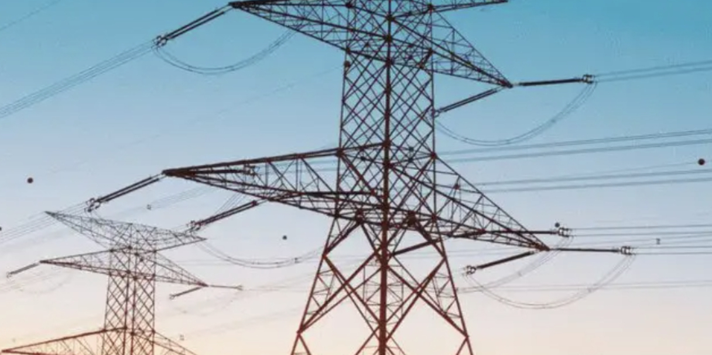

# Optimal Power Flow (OPF) for High Voltage Direct Current Transmission (HVDC) (Matlab Code Implementation)

1. Overview of China's High Voltage Technology Leading Globally, Deserving Our Pride!
High Voltage Direct Current (HVDC) is a mature technology capable of long-distance power transmission and achieving interconnection between different networks in sync. The most common configuration for high voltage direct current (HVDC) involves two converter stations connected via overhead power lines or submarine cables, as shown in Figure 1a. However, future power systems will require meshed DC networks for SuperGrids [1] and offshore wind farms [2]. Such types of DC grids, namely Multi-Terminal High Voltage Direct Current Transmission Systems (MT-HVDC), are feasible due to the development of high-power switching semiconductor devices and DC circuit breakers [3].
Recent studies have shown that dense meshed multi-terminal high voltage direct current grids have advantages in efficiency and safety [4]. However, these types of grids are more challenging to control than traditional point-to-point lines. They require reliable communication between terminals and optimization algorithms to find the optimal operating point.
Moreover, highly grid-connected MT-HVDC systems require DC/DC station interconnections with different nominal voltages or configurations (e.g., single-pole, double-pole, same-polarity) for HVDC systems. DC/DC stations can control active power on specific HVDC lines (see Figure 1b) and assist MT-HVDC during disturbances such as DC faults.
The traditional methods of power system operation, such as Optimal Power Flow (OPF), must adapt to this new environment. Like its corresponding AC system, the optimal power flow for multi-terminal high voltage direct current systems is a nonlinear and non-convex problem. This presents both theoretical and practical challenges. Including DC/DC converters in the model would increase complexity, as they involve additional control variables and nonlinear equations related to power losses.
This paper proposes a nonlinear model for optimal power flow in multi-terminal high-voltage direct current (HVDC) transmission systems. The proposed method only considers the DC side of the grid and includes branches with DC/DC converters. The optimization model also takes into account line losses and DC/DC converters. To obtain a unique solution for real-time operation, a semidefinite limit approximation method is proposed. This method was evaluated on a simplified version of the CIGRE B4 DC grid test system. The results show that the proposed approximation is efficient and accurate compared to the nonlinear model solved using GAMS. Mathematical models are described in Part 3.

For complete code implementation and explanation, please refer to the following section:
%% Approximate Feature Value\n[V,D] = eig(X);\nlm = diag(D);\nvm = V(:,NumN);\nvm*vm'*lm(NumN);\ndisp('---------------- Power loss ----------------');\ntrace(G*X)\ndisp('---------------- Voltage --------------------');\nVap = sqrt(lm(NumN))*vm;\ndisp(Vap);\ndisp('---------------- Line flow-------------');\nkk = 0;\nfor k = 1:NumL\n    kk = kk +1;\n    fprintf('%i%s%i%s%f\n',MT.Lines(k,1),' -> ',MT.Lines(k,2),' : ',F(kk));\n    kk = kk +1;\n    fprintf('%i%s%i%s%f\n',MT.Lines(k,2),' -> ',MT.Lines(k,1),' : ',F(kk));\nend\ndisp('---------------- DC/DC Transformer -----------');\nQp\n  
4 Results

## Images

<!-- PAYMENT_BLOCK -->

## Get this dataset

- Payment link (Stripe): [Buy now](https://buy.stripe.com/3cs8yP7sY87d0vu9AB)
- Payment QR code: 

<!-- /PAYMENT_BLOCK -->
